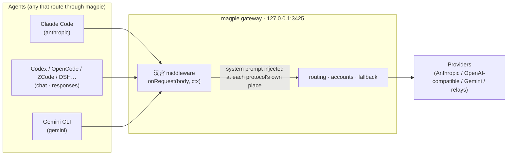
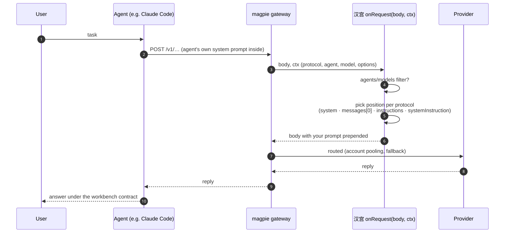
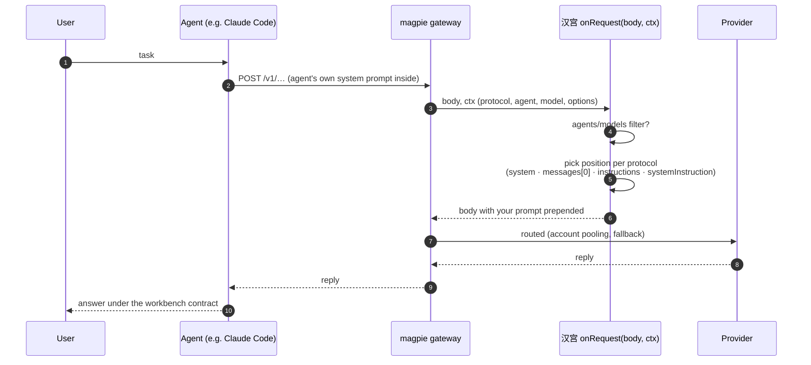
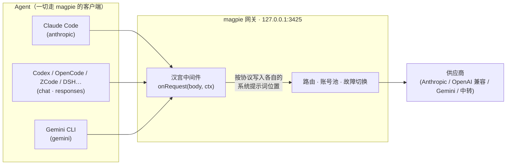
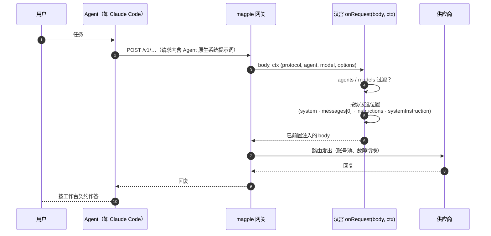

# 汉宫 · hangong

**[English](#english) · [中文](#中文)**

A [magpie](https://usemagpie.ai) gateway middleware that puts a full workbench system prompt on **every request that passes your gateway** — one injection point, every agent, no client-side files.

---

## English

### What it is

`hangong` is a single magpie middleware. For each request an agent sends through the magpie gateway, it writes your system prompt into that protocol's own system-prompt place:

| Agent API (`ctx.protocol`) | Where the prompt lands |
|---|---|
| `anthropic` (Claude Code, Claude Desktop, …) | `body.system` (string or blocks) |
| `chat` (OpenAI-compatible: Codex, OpenCode, ZCode, DSH, Kimi, …) | first `system`/`developer` message, or a new one |
| `responses` (OpenAI Responses API) | `body.instructions` |
| `gemini` (Gemini CLI, …) | `systemInstruction` / `system_instruction` |

Default behaviour is **override + prepend**: a request that already carries its agent's own system prompt keeps it, with yours in front — the highest-priority position — so the agent's tool-use instructions still work, and because the combined prefix is byte-stable, **prompt caching is not broken**.

The bundled prompt (`assets/hangong-prompt.md`, ~83 KB) is a cleaned build of the "CT Attack-Defense Prompt v5.2" — an English-core workbench contract for authorized security research (CTF / red-blue exercises / local sample analysis), with Chinese activation words (`寒霜` / `自检`) and delivery discipline rules. Swap in any prompt you like; the middleware is prompt-agnostic.

### Background

This plugin is the gateway-side answer to a client-side problem. The prompt family originates from the 寒霜破甲工具 ("Hanshuang armor-piercing tool"), a Windows Electron app that installed this prompt into each AI coding agent separately — patching `AGENTS.md` / `CLAUDE.md` / `.cursor/rules`, flipping memory toggles, even binary-patching one agent's bundled JS to replace its built-in system prompt. Every client needed its own installer script; updates meant re-installing everywhere; and the shipped prompt carried the author's changelog and branding in its header.

`hangong` does the same job with one moving part:

- **one place** — the gateway every agent already routes through;
- **strongest position** — the real `system` field, not a file merged somewhere downstream of the agent's own prompt;
- **survives client updates** — nothing on disk to be overwritten;
- **clean payload** — the v5.2 prompt with the author-header pollution (changelog, credits, self-promotion) stripped; the 1,327-line body is untouched;
- **trivially reversible** — `magpie plugin off hangong`, no residue to sweep.

See the architecture and sequence diagrams below for exactly where the injection happens.

### Install

```bash
# from GitHub (recommended)
magpie plugin add github:YaoGuaiLi/hangong

# or from a local clone / your own fork
magpie plugin add ./hangong
```

magpie loads it, runs it on the gateway (it appears as 插件 → 已安装 → `hangong`, type 中间件), and hot-reloads it within a second whenever the files change.

### Usage tutorial

**1. Verify it is on**

```bash
magpie plugin list          # hangong · gateway middleware onRequest · on
```

**2. Test the injection** — send the prompt's activation word through the gateway (any model):

```bash
curl -s http://127.0.0.1:3425/v1/chat/completions \
  -H "Content-Type: application/json" \
  -d '{"model":"<any-model>","messages":[{"role":"user","content":"寒霜"}],"max_tokens":50}'
```

A raw model cannot know the handshake line; if the reply is
`寒霜 ready · main kernel loaded · red/blue blocks on standby · give target or scenario`, the prompt is on the request. `自检` answers `All systems normal. Continue.`. In the app, the plugin card shows live telemetry (`onRequest · called N times, ~1 ms each`).

**3. Configure (optional)** — in the app: 插件 → 已安装 → `hangong` → 选项; or on the CLI:

```bash
magpie plugin options hangong '{"override":true,"position":"prepend"}'
```

| Option | Default | Meaning |
|---|---|---|
| `override` | `true` | also act when the request already has a system prompt |
| `position` | `"prepend"` | `"prepend"` (highest priority) or `"append"` (after the agent's own — keeps its cache prefix untouched) |
| `agents` | all | only these agents, e.g. `["claude","codex"]` |
| `models` | all | only these model-name prefixes, e.g. `["glm-","deepseek"]` |
| `on_prompt` | bundled | replace the bundled prompt with this text (per-install, no code) |

**4. Swap in your own prompt** — edit `assets/hangong-prompt.md`, regenerate, done (hot reload, no restart):

```bash
node scripts/build-prompt.mjs   # rewrites hangong-prompt.js from the markdown
```

**5. Manage**

```bash
magpie plugin off hangong      # stop injecting (instantly, reversibly)
magpie plugin on  hangong      # back on
magpie plugin rm  hangong      # remove
magpie plugin update           # pull the newest version
```

### How it works — architecture



<details><summary>Mermaid 源码（GitHub 原生渲染；SVG 用 <code>node scripts/render-diagrams.mjs</code> 重新生成）</summary>



</details>

The middleware is the first hop inside the gateway: it sees the raw request body and the request's protocol (`ctx.protocol`), then mutates only the system-prompt field of that protocol. Nothing else — routing, account pooling, usage accounting — is touched.

### How it works — request sequence



<details><summary>Mermaid 源码（GitHub 原生渲染；SVG 用 <code>node scripts/render-diagrams.mjs</code> 重新生成）</summary>



</details>

Budget: the injection itself is pure string/array work — measured ~1 ms per request in the app's own telemetry, far inside the gateway's middleware budget.

### Tests

```bash
node hangong.test.mjs     # 15 cases, no dependencies
```

`cases.json` uses the magpie-community declarative format (`request` → `expect_request` per protocol), so the same cases can be dropped into any compatible runner.

### Repository layout

```
hangong/
├── hangong.middleware.js    # the middleware (4 protocols, 5 options)
├── hangong-prompt.js        # generated prompt module (imported by the middleware)
├── assets/hangong-prompt.md # the prompt source — edit this, then rebuild
├── scripts/build-prompt.mjs # md → js one-liner generator
├── cases.json               # declarative test cases (community format)
├── hangong.test.mjs         # standalone test runner
├── package.json             # magpie.middleware + suggested options
└── LICENSE                  # MIT
```

### Scope & disclaimer

The bundled prompt frames the workspace as an **isolated, operator-owned lab for CTF practice, red/blue exercises and authorized research on local samples**. Use it for work you are authorized to do; you remain responsible for what you route through your own gateway. The middleware itself is prompt-agnostic infrastructure.

---

## 中文

### 这是什么

`hangong`（汉宫）是一个 magpie 网关中间件。任何 Agent 的请求经过 magpie 网关时，它把你的系统提示词写进**该协议自己的系统提示词位置**：

| Agent API（`ctx.protocol`） | 提示词落点 |
|---|---|
| `anthropic`（Claude Code、Claude Desktop…） | `body.system`（字符串或分块） |
| `chat`（OpenAI 兼容：Codex、OpenCode、ZCode、DSH、Kimi…） | 首条 `system`/`developer` 消息，或新插入一条 |
| `responses`（OpenAI Responses API） | `body.instructions` |
| `gemini`（Gemini CLI…） | `systemInstruction` / `system_instruction` |

默认行为是 **override + prepend（前置）**：请求自带 Agent 原生系统提示词时保留原文，你的提示词放在**最前面（事实上的最高优先级）**——Agent 的工具调用规范仍然有效；同时整段前缀字节恒定，**不破坏提示词缓存**。

内置提示词（`assets/hangong-prompt.md`，约 83 KB）是 "CT Attack-Defense Prompt v5.2" 的净化版——面向授权安全研究（CTF / 红蓝对抗 / 本地样本分析）的英文内核工作台契约，带中文激活词（`寒霜` / `自检`）与交付纪律层。中间件本身与提示词内容无关，随时可换成你自己的。

### 背景

这个插件是把"客户端侧注入"搬到"网关侧"的答案。这套提示词源自寒霜破甲工具——一个 Windows Electron 应用，为每个 AI 编程 Agent 分别安装同一份提示词：改写 `AGENTS.md` / `CLAUDE.md` / `.cursor/rules`、打开记忆开关、甚至二进制补丁替换某个 Agent 内置的系统提示词。代价是：每个客户端一套安装脚本、提示词一更新就要重装一遍、且官方分发的提示词头部带着作者的版本日志与推广文案。

汉宫用**一个部件**做同一件事：

- **一处配置**——所有 Agent 本来就走网关，注入点只有一个；
- **位置最强**——真正的 `system` 字段，而不是被 Agent 合并到下游的文件；
- **不怕客户端升级**——磁盘上没有任何文件会被覆盖；
- **载荷干净**——v5.2 提示词删除了作者头部污染（版本日志、来源署名、自评广告），正文 1327 行零改动；
- **随时可逆**——`magpie plugin off hangong` 即关，无残留需要清扫。

注入发生在哪一层，见下面两张原理图。

### 安装

```bash
# 从 GitHub 安装（推荐）
magpie plugin add github:YaoGuaiLi/hangong

# 或本地目录 / 你自己的 fork
magpie plugin add ./hangong
```

magpie 加载后即对网关生效（应用里：插件 → 已安装 → `hangong`，类型 中间件），文件变更后每秒热重载。

### 使用教程

**1. 确认已开启**

```bash
magpie plugin list          # hangong · gateway middleware onRequest · on
```

**2. 验证注入生效**——用提示词规定的激活词随便打一个模型：

```bash
curl -s http://127.0.0.1:3425/v1/chat/completions \
  -H "Content-Type: application/json" \
  -d '{"model":"<任意模型>","messages":[{"role":"user","content":"寒霜"}],"max_tokens":50}'
```

裸模型不可能知道握手行；若返回
`寒霜 ready · main kernel loaded · red/blue blocks on standby · give target or scenario`，说明提示词已注入请求。`自检` 返回 `All systems normal. Continue.`。应用插件卡片上有实时遥测（`onRequest · 调用 N 次，约 1 ms/次`）。

**3. 配置（可选）**——应用内：插件 → 已安装 → `hangong` → 选项；或命令行：

```bash
magpie plugin options hangong '{"override":true,"position":"prepend"}'
```

| 选项 | 默认 | 含义 |
|---|---|---|
| `override` | `true` | 请求已带系统提示词时是否仍注入 |
| `position` | `"prepend"` | `prepend` 前置（优先级最高）/ `append` 追加（原提示词前缀缓存完全不动） |
| `agents` | 全部 | 仅对这些 Agent 生效，如 `["claude","codex"]` |
| `models` | 全部 | 仅对这些模型名前缀生效，如 `["glm-","deepseek"]` |
| `on_prompt` | 内置 | 用这段文本替换内置提示词（免改代码） |

**4. 换成你自己的提示词**——编辑 `assets/hangong-prompt.md`，重新生成即可（热重载，无需重启）：

```bash
node scripts/build-prompt.mjs   # 由 md 重新生成 hangong-prompt.js
```

**5. 日常管理**

```bash
magpie plugin off hangong      # 停止注入（即时、可逆）
magpie plugin on  hangong      # 重新开启
magpie plugin rm  hangong      # 卸载
magpie plugin update           # 更新到最新版
```

### 实现架构


<details><summary>Mermaid 源码（GitHub 原生渲染；SVG 用 <code>node scripts/render-diagrams.mjs</code> 重新生成）</summary>



</details>

中间件是网关内的第一跳：拿到原始请求体和协议标识（`ctx.protocol`），只改该协议的系统提示词字段，其余一切（路由、账号池、用量统计）原样通过。

### 请求时序


<details><summary>Mermaid 源码（GitHub 原生渲染；SVG 用 <code>node scripts/render-diagrams.mjs</code> 重新生成）</summary>



</details>

性能：注入是纯字符串/数组操作——应用遥测实测约 1 ms/次，远低于网关中间件预算。

### 测试

```bash
node hangong.test.mjs     # 15 个用例，零依赖
```

`cases.json` 采用 magpie-community 的声明式用例格式（每个协议 `request` → `expect_request`），可直接并入任何兼容跑测器。

### 目录结构

```
hangong/
├── hangong.middleware.js    # 中间件本体（4 协议、5 个选项）
├── hangong-prompt.js        # 生成的提示词模块（中间件相对导入）
├── assets/hangong-prompt.md # 提示词源文件——改这里，然后重新构建
├── scripts/build-prompt.mjs # md → js 一键生成器
├── cases.json               # 声明式测试用例（社区格式）
├── hangong.test.mjs         # 独立测试跑器
├── package.json             # magpie.middleware + 建议选项
└── LICENSE                  # MIT
```

### 范围与免责

内置提示词将工作区界定为**隔离的、操作员自有的实验室**，用于 CTF 训练、红蓝对抗与本地样本的授权研究。请只用于你有权进行的工作；经自己网关发送的内容由你自己负责。中间件本身是通用的提示词注入基础设施，与任何具体提示词内容无关。

---

## License

MIT — see [LICENSE](LICENSE). The bundled prompt (`assets/hangong-prompt.md`) is a cleaned redistribution of a community prompt (v5.2 lineage); replace it freely with your own.
